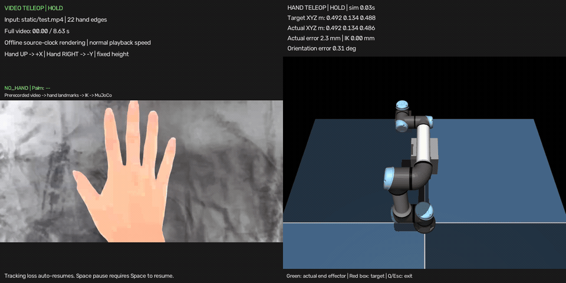

# AirArm

普通摄像头驱动仿真机械臂的交互项目。



## 摄像头手部识别与仿真机械臂联动：

```sh
uv run --locked python main.py --mode teleop
```

窗口左侧显示手部，右侧显示机械臂。启动保持静止；单手进入画面后按空格启用，慢慢移动手掌即可控制机械臂。空格暂停/重新对齐，`I` 切换关键点编号，`Q/Esc` 退出。丢手、多手或输入过期导致的暂停，在正常单手检测恢复后会自动继续；空格造成的手动暂停只能再次按空格解除。

默认平滑时间为 0.04 秒，目标限速为 0.25 米/秒。可以用 `--smoothing` 和 `--target-speed` 调整跟随响应：

```sh
uv run --locked python main.py --mode teleop --smoothing 0.04 --target-speed 0.25
```

## 三目标挑战（显示当前可操作平面、目标区域及运动轨迹）

```sh
uv run --locked python main.py --mode challenge
```

单手出现后按空格开始，用实际末端进入橙色目标圈并停留 0.5 秒。三个目标依次完成后冻结画面并显示总用时；点击 Retry 或按 `R` 重新挑战，点击 Quit 或按 `Q/Esc` 退出。完成的运动自动保存到 `recordings/airarm-时间-编号.json`，每轮保留独立文件。

## 仅回放已保存的机械臂运动（不使用摄像头）

```sh
uv run --locked python main.py --mode replay --trajectory recordings/你的轨迹文件.json
```

将上面的文件名替换为完成时终端打印的实际文件。使用、计分规则、轨迹格式和代码导读见 [三目标挑战与轨迹回放](docs/DAY5_CHALLENGE_REPLAY.md)。


## 从项目根目录运行现有手部识别

```sh
uv run --locked python main.py
```

## 运行机械臂预设目标演示

```sh
uv run --locked python main.py --mode arm
```

## 键盘控制

```sh
uv run --locked python main.py --mode arm --control keyboard
```

`W/S` 调整世界 X，`A/D` 调整世界 Y，`H` 返回初始目标，空格保持/恢复，`Q/Esc` 退出。

机械臂资源使用 Mink 配套 UR5e 场景。测试使用真实模型与物理仿真；控制测试不需要摄像头、图形窗口或 GPU。
